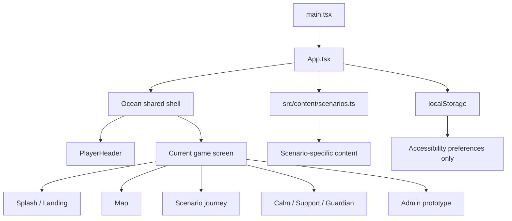

# Feelings - Nova's Emotion Adventure

## Technical Documentation

**Document version:** 1.0
**Application type:** Front-end interactive web game
**Primary audience:** Teenagers aged 13-17
**Primary languages:** Arabic (RTL) and English (LTR)

---

## 1. Product Overview

Feelings is an underwater emotion-simulation adventure. The player is accompanied by **Nova**, a gender-neutral starfish, through realistic emotional situations. Rather than presenting a conventional quiz, the game turns each situation into a short interactive journey:

1. Discover a mysterious underwater signal.
2. Reveal the scene behind the signal.
3. Identify the emotion that best fits the moment.
4. Choose one of three possible responses.
5. Read the consequence or “ripple effect” of that response.
6. Reflect, return to the map, or use support tools.

The current authored content covers school pressure, cyberbullying, and family misunderstanding. Completing all three core situations unlocks a closing message, quick emotional-care advice, support guidance, and parent/guardian conversation prompts.

## 2. Scope

### Included in the current release

- Responsive single-page React game experience.
- Arabic and English gameplay, with RTL/LTR layout support.
- Underwater visual shell, Nova artwork, effects, map, scenario flow, and support screens.
- Three bilingual, fully authored scenarios.
- A dynamic S-current map with equal marker distribution.
- Accessibility settings stored locally in the browser.
- A visual admin/content-management prototype for future work.

### Not included in the current release

- Authentication or user accounts.
- Database, API, server-side storage, or analytics.
- Persistent player progress, reflections, or published admin content.
- Real file upload or media processing.
- A production content approval workflow.
- Automated unit, integration, or end-to-end test suites.

## 3. Technology Stack

| Layer | Technology | Purpose |
| --- | --- | --- |
| UI | React 19 | Component rendering and local state management |
| Language | TypeScript (strict mode) | Type-safe UI and content model |
| Build tool | Vite 8 | Development server and production bundle |
| Styling | Tailwind CSS 4 + custom CSS | Design system, effects, responsive layouts |
| Formatting | oxfmt | Source formatting |
| Assets | Local JPG and PNG files | Nova, underwater environments, UI artwork |

## 4. Application Architecture

The application is a client-side React single-page app. There is no router library or backend. `App.tsx` acts as a small state machine and chooses which screen to render from the current `screen` value.



### Primary files

| Path | Responsibility |
| --- | --- |
| `src/main.tsx` | React application entry point |
| `src/App.tsx` | Screen state machine, shared shell, map, player flow, support, and admin prototype |
| `src/index.css` | Visual language, responsive rules, animation, and accessibility presentation |
| `src/content/scenarios.ts` | Bilingual scenario content, choices, outcomes, and content types |
| `public/assets/` | Local visual assets used by the interface |
| `vite.config.ts` | Vite, React, Tailwind, local dev-server, and Figma Make configuration |

## 5. Screen Model and Game Flow

The `Screen` union in `src/App.tsx` defines the available player, support, foundation, and admin views.

```text
Splash
  -> Landing
  -> Map
  -> Mystery
  -> Scene
  -> Emotion
  -> Behavior
  -> Outcome
  -> Map or Quiet Space

After all three core scenarios are complete:
  -> Closure
  -> Quiet Space / Support / Guardian guidance / Map
```

### Player-facing screens

| Screen | Purpose |
| --- | --- |
| `splash` | Brief branded entry experience |
| `landing` | Main entry point, guide, language, and accessibility access |
| `map` | S-shaped world map and signal selection |
| `mystery` | Contextual but non-spoiling signal introduction |
| `scene` | Full description of the real-life situation |
| `emotion` | Emotion recognition question and options |
| `behavior` | Three possible actions with different consequences |
| `outcome` | Chosen action's consequence and a personal reflection prompt |
| `closure` | End-of-journey advice after the three core scenarios |
| `calm` | Quiet Space and 4-4-4 breathing exercise |
| `support` | Trusted-person, home, school, and safety guidance |
| `guardian` | Scripted prompts for speaking with a parent or guardian |

## 6. Scenario Content Architecture

All authored playable content lives in `src/content/scenarios.ts`. It keeps Arabic and English copy together so a scenario cannot accidentally have mismatched language content.

```ts
type LocalizedText = {
  ar: string;
  en: string;
};

type ScenarioContent = {
  id: number;
  internalTitle: LocalizedText;
  mystery: {
    label: LocalizedText;
    eyebrow: LocalizedText;
    title: LocalizedText;
    body: LocalizedText;
  };
  scene: {
    heading: LocalizedText;
    body: LocalizedText;
  };
  emotion: {
    question: LocalizedText;
    hint: LocalizedText;
    options: ScenarioEmotionOption[];
  };
  behavior: {
    question: LocalizedText;
    hint: LocalizedText;
    options: ScenarioAction[];
  };
  reflectionPrompt: LocalizedText;
};
```

Each `ScenarioAction` owns its outcome. This prevents the interface from using one generic result for every situation.

```ts
type ScenarioAction = {
  id: string;
  icon: "avoid" | "impulse" | "regulate";
  tag: LocalizedText;
  name: LocalizedText;
  note: LocalizedText;
  outcome: {
    eyebrow: LocalizedText;
    title: LocalizedText;
    body: LocalizedText;
  };
};
```

### Current authored scenarios

| Order | Map region | Scenario | Preferred protective action |
| --- | --- | --- | --- |
| 1 | School | Surprise difficult test and time pressure | Pause, breathe, start with easier questions |
| 2 | Digital World | Cyberbullying in a group chat | Document, block/leave, and seek trusted-adult support |
| 3 | Home | Being blamed before being heard | Pause and explain calmly and clearly |

### Adding a new playable core scenario

The current front-end is intentionally strict: metadata created through the admin prototype does not open an unrelated reused story. A new full scenario needs all of the following before it should be considered playable:

1. Add a complete bilingual `ScenarioContent` object to `src/content/scenarios.ts`.
2. Add the matching map metadata (`region`, `duration`, initial status, and mystery label) to the initial scenario mapping in `src/App.tsx`.
3. Give the scenario a unique numeric ID shared by the content object and map record.
4. Verify its scene, three emotion choices, three behavior choices, and all three outcomes in both languages.
5. Run the type check and manually play the journey on desktop and mobile.

In a production version, map metadata should be moved into the content schema or supplied by a backend so a newly published scenario needs no manual code update.

## 7. World Map Implementation

The map is an expandable vertical world instead of a fixed three-button menu.

### S-current layout

`buildRouteLayout()` generates the central route as a sampled sine curve:

```text
x = 500 + 270 * sin(t * PI * cycles - PI / 2)
y = 90 + t * (canvasHeight - 180)
```

The implementation samples the path, accumulates its arc length, and positions each map marker at an equal fraction of total route length. This produces even visual spacing as the number of published scenarios changes.

### Player controls

- Vertical mouse/touch drag and scrolling.
- Zoom in, zoom out, and reset controls.
- Region filters and mystery-signal search.
- Minimap with a moving orb that reflects vertical map progress.
- Scenario markers with available, started, and complete states.

## 8. State Management and Persistence

No global state library is used. `App.tsx` uses React hooks for all runtime state.

| State | Purpose | Persistence |
| --- | --- | --- |
| `screen` | Current application screen | Session only |
| `language` | Arabic or English | Session only |
| `scenarios` | Map signals and completion state | Session only |
| `activeScenarioId` | Scenario currently being played | Session only |
| `selectedEmotion` | Selected emotion option | Session only |
| `selectedAction` | Selected behavior/action option | Session only |
| `accessibility` | Player visual/accessibility preferences | Browser `localStorage` |
| `draft` | Admin prototype metadata draft | Session only |

Accessibility data is stored under the localStorage key `feelings-accessibility`. Player reflections are intentionally not persisted or transmitted.

## 9. Accessibility and Localization

### Accessibility controls

- Four text-size modes: small, default, large, and extra large.
- Color-vision modes: default, protanopia, deuteranopia, and tritanopia.
- High-contrast mode.
- Reduced-motion setting, with the operating-system reduced-motion preference used as the default.
- Captions setting.
- Focus-highlight setting.
- Keyboard-accessible buttons and clearly labelled controls.

### Localization behavior

- Arabic uses `dir="rtl"`; English uses `dir="ltr"`.
- Scenario strings are stored as `{ ar, en }` objects.
- The map uses a separate English mystery label when available, preventing Arabic labels from appearing in English mode.
- The shared game shell reverses layout direction with the selected language.

## 10. Support and Safety Content

The support design is informational and not a substitute for emergency or clinical services.

The application guides the player toward trusted adults, home support, school support, and specialist/local services when appropriate. It also calls out situations involving ongoing distress, bullying, threats, lack of safety, loss of control, or urges to self-harm as reasons to tell a trusted adult immediately.

For a production deployment, local emergency and child/family support contacts must be reviewed and added by qualified local stakeholders before public release.

## 11. Development Setup

### Requirements

- Node.js compatible with the project toolchain.
- Corepack and pnpm.

### Install and run

```bash
corepack enable
corepack pnpm install
corepack pnpm dev
```

The Vite configuration uses port `8443` by default. Open:

```text
http://localhost:8443
```

To use another port:

```bash
PORT=5173 corepack pnpm dev
```

On Windows Command Prompt, use:

```bat
set PORT=5173 && corepack pnpm dev
```

### Production build

```bash
corepack pnpm build
corepack pnpm preview
```

Vite produces the static production output in `dist/`. It can be deployed to a static hosting provider after a successful build.

## 12. Configuration

| Variable | Default | Purpose |
| --- | --- | --- |
| `PORT` | `8443` | Local Vite dev/preview port |
| `FIGMA_DEV_SERVER_HOST` | `0.0.0.0` | Host used by the local Vite configuration |
| `FIGMA_PUBLIC_URL` | Not set | Optional base URL used by the Figma Make environment |

## 13. Quality Assurance

### Completed checks

- TypeScript no-emit verification completed successfully after the Stage 2 content integration.
- `git diff --check` completed without whitespace errors.
- Scenario flow was reviewed for all three authored journeys, map ordering, bilingual labels, completion, and end-of-journey access.

### Recommended manual acceptance test

1. Launch the game in Arabic, complete each scenario, and verify the correct action outcome appears.
2. Switch to English and verify no Arabic mystery labels or RTL layout remain.
3. Open Quiet Space and confirm all three 4-second stages occur: inhale, hold, exhale.
4. Complete the three scenarios, including returning through Quiet Space once, and verify the closing screen unlocks.
5. Test map drag, scroll, zoom, filters, search, and minimap on desktop.
6. Test the landing, map, content cards, and support screens at a narrow mobile width.
7. Test text scaling, high contrast, reduced motion, and keyboard focus behavior.

## 14. Known Limitations and Recommended Roadmap

| Priority | Next improvement | Why it matters |
| --- | --- | --- |
| High | Backend and authenticated admin API | Persist scenarios, publish state, and media safely |
| High | Database schema for complete scenario content | Allow real authoring without source-code changes |
| High | Media storage and validation | Support scenario-specific image/video uploads |
| High | Professional content moderation workflow | Review sensitive content before publication |
| Medium | Persistent player progress (privacy-first) | Let players resume only with an informed consent model |
| Medium | Automated tests | Protect scenario flow, accessibility, and map logic during changes |
| Medium | Local reviewed help contacts | Make the support experience actionable in the launch region |
| Low | Analytics with consent | Measure usability without collecting unnecessary personal data |

## 15. Security and Privacy Notes

- The current application sends no player data to a server because there is no backend.
- Accessibility preferences are the only state written to browser storage.
- Reflections are not saved after the player leaves the outcome screen.
- Do not add user accounts, sensitive notes, location data, or crisis-related records without a dedicated privacy, safeguarding, and security review.
- Do not expose access tokens, API keys, or private support data in the front-end repository.
